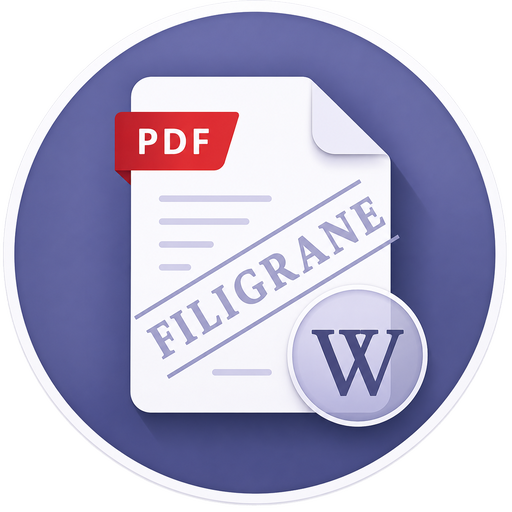

**A Modern GNOME Application for Watermarking PDF Documents**

## Overview

**Filigrane** is a native, modern GNOME desktop application designed to easily add text and image watermarks to a PDF document with real-time preview, presets management, and fine-grained positioning controls.

## Features

- **Text Watermarks**: Custom fonts, size, colors, opacity, rotation angle, and text style (bold, italic, underline).
- **Image Watermarks**: Import PNG, SVG, or JPEG logos with scaling, rotation, and aspect ratio lock.
- **Placement Presets**: Center, Top-Left, Top-Right, Bottom-Left, Bottom-Right, Tiled Grid, or Custom % coordinates.
- **Smart & Secure Document Protection**: Prevent editing or removing watermarks with external PDF tools (Adobe Acrobat, Inkscape, Master PDF Editor) using AES-256 permission encryption and optional anti-tamper page flattening mode.
- **Real-time Live Preview**: View watermark positioning live before saving.
- **Watermark Presets**: Save and load custom watermark parameter presets.
- **GNOME Integration**: Built with GTK4 and Libadwaita for dark/light mode integration.

## Website

The website is available at: [https://demsking.gitlab.io/filigrane](https://demsking.gitlab.io/filigrane)

## Contribute

Please follow [CONTRIBUTING.md](https://gitlab.com/demsking/filigrane/blob/main/CONTRIBUTING.md).

## Versioning

Given a version number `MAJOR.MINOR.PATCH`, increment the:

- `MAJOR` version when you make incompatible API changes,
- `MINOR` version when you add functionality in a backwards-compatible manner,
  and
- `PATCH` version when you make backwards-compatible bug fixes.

Additional labels for pre-release and build metadata are available as extensions
to the `MAJOR.MINOR.PATCH` format.

See [SemVer.org](https://semver.org/) for more details.

## License

GNU GENERAL PUBLIC LICENSE
Version 3, 29 June 2007

    Copyright © 2026 Sébastien Demanou <demsking@gmail.com>

Everyone is permitted to copy and distribute verbatim copies
of this license document, but changing it is not allowed.

You may obtain a copy of the License at
[LICENSE](https://gitlab.com/demsking/pixie/blob/main/LICENSE).
